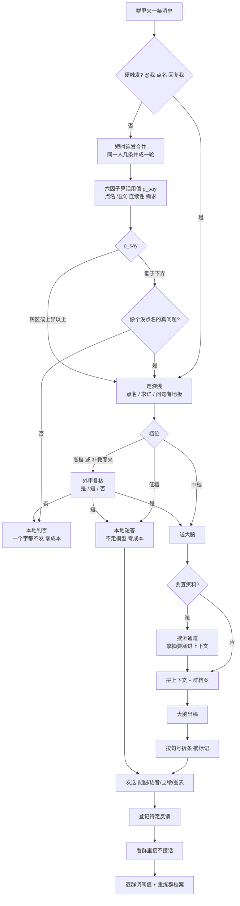
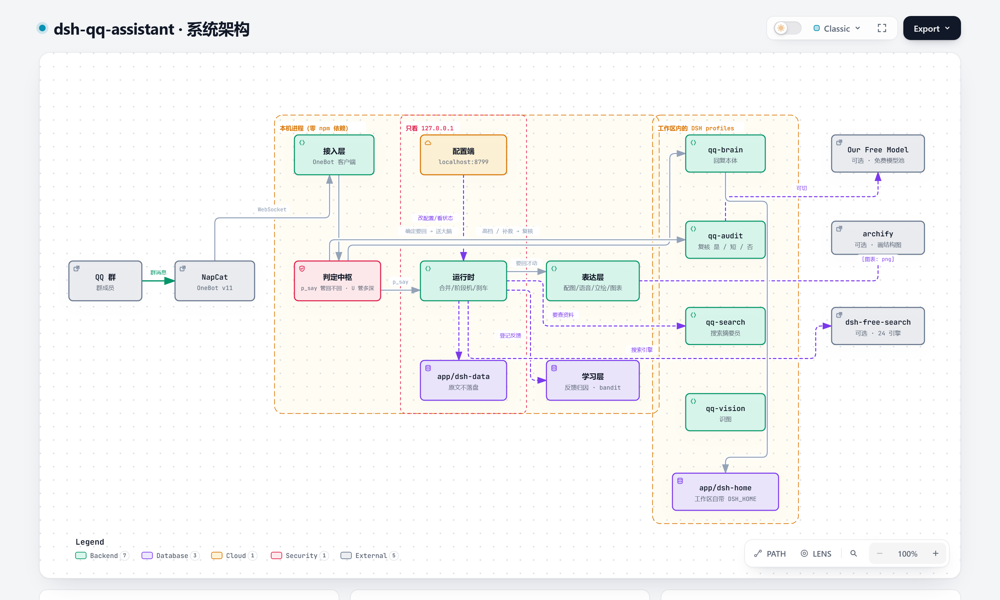
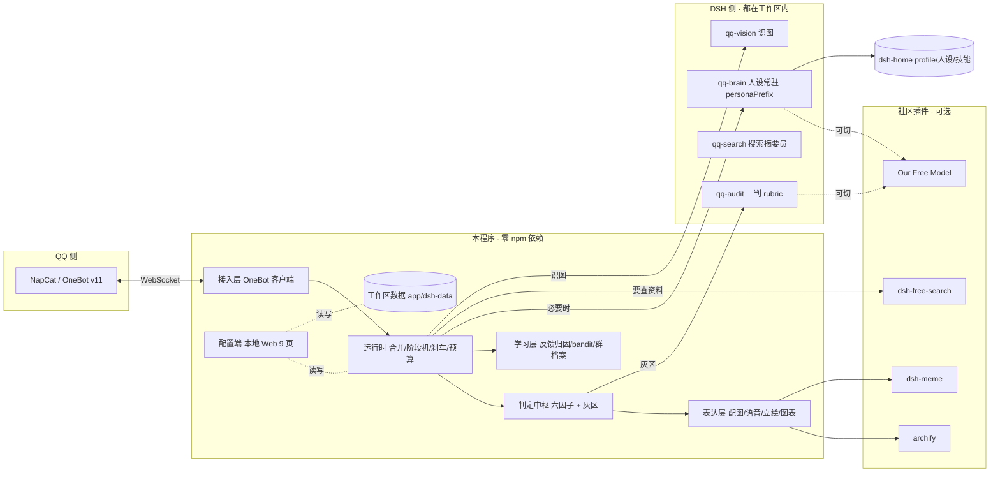
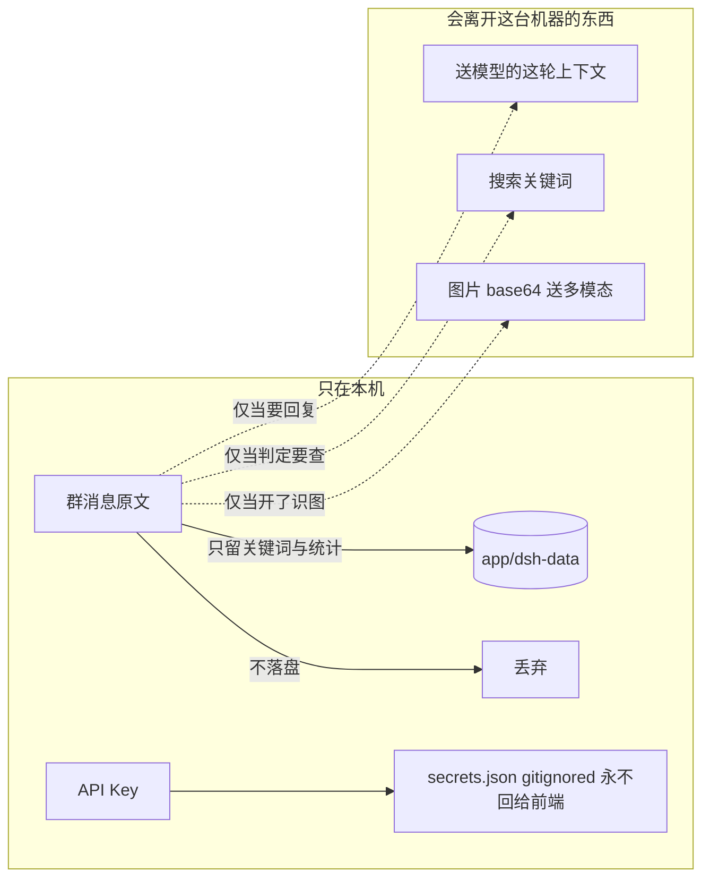

<div align="center">


# DSH-QQ 群小助手

**常驻 QQ 群、有性格、会自己判断该不该开口的小助手**

它不是一个"有问必答"的机器人 —— 它先**自己判断**这条消息是不是在跟它说话，
再决定**说不说 / 说多深 / 要不要先搜 / 配不配图**；只有真需要时才动大脑。
然后它会看着群里的反应慢慢**自学习**，越来越像这个群的人。

[](#测试与证据)
[](#测试与证据)
[](https://nodejs.org/)
[](#零依赖)
[](LICENSE)

</div>

---

## 目录

- [它聪明在哪](#它聪明在哪)
- [它怎么想事](#它怎么想事)
- [系统架构](#系统架构)
- [快速开始](#快速开始)
- [需要你自己准备的东西](#需要你自己准备的东西)
- [额外功能与社区插件兼容](#额外功能与社区插件兼容)
- [隐私：数据都去哪了](#隐私数据都去哪了)
- [成本](#成本)
- [零依赖](#零依赖)
- [测试与证据](#测试与证据)
- [项目结构](#项目结构)
- [常见问题](#常见问题)
- [文档](#文档)
- [许可](#许可)

---

## 它聪明在哪

| | 普通群机器人 | 本程序 |
|---|---|---|
| **什么时候说话** | 被 @ 就回 | 六因子算「话用值」，低于开口线就**闭嘴**；**没点名但像个真问题**会被救回来再复核 |
| **说多深** | 一律长答 | 三档：短评 / 总结 / 详细，各档字数自己定；**被点名 / 要求展开 / 问句有地板**——至少进中档走大脑，不会被"成本"压成"嗯？/啥事" |
| **该不该回 / 说多长** | 一刀切 | **外审复核**三档：**是**（认真回）/ **短**（一句就够）/ **否**（不回）；8 秒超时 → 不确定 |
| **要不要查资料** | 直接答 | 判定要查才搜，搜完把摘要塞进上下文 |
| **配不配图** | 固定 | 按情绪标记配图；详细档**一律不配** |
| **新群** | 立刻插话 | 先**观察 80 条**只判定不发言 → 半自动 → 全自动 |
| **被嫌烦** | 不知道 | 按「有没有人接着说」自学习，逐群调优 |

## 它怎么想事

每一条群消息都走同一条流水线；**只有走到最后一段才会花钱**：



> 除了上面这条主链，还有四道"回不回"的闸门：**刹车**（STOP / 暂停 / 群内 /停）、**预算**、
> **新群观察期**、**半自动只回点名**，以及可选的**每群每小时上限**。任何一道关了就一个字都不发。

**这张图想说的是**：左边那一半全是**本地算法**，一分钱不花；只有 `送大脑` 那一步会调模型。
所以"话用值"算得准不准，直接决定这个月的账单。

## 系统架构



*上图是拿项目自己的 **archify** 画的（源文件 [architecture.json](docs/diagrams/architecture.json)，改完可重新渲染）。
下面这张 Mermaid 是**纯文本、可编辑、能 diff** 的版本——两版讲的是同一套结构。*



**关键设计**：

- **人设常驻系统提示词最前段**（`personaPrefix`）—— 每次调用前缀逐字节相同，吃满 DeepSeek 的**前缀缓存**，实测命中率 94~96%
- **一个 profile + 三档补丁**，而不是三个 profile —— 人设前缀在三档之间共享，缓存不会因为换档而失效
- **工作区自带 DSH_HOME** —— 人设、profile、技能、数据全在 `app/` 下面，**一行都不写你的 `~/.dsh`**
- **群与群之间状态隔离** —— 阶段、阈值、群档案、反馈统计都是按群存的

## 快速开始

```bash
git clone https://github.com/wingbire/dsh-qq-assistant.git
cd dsh-qq-assistant

# 1. 自检（不需要 QQ、不需要 key）
node test/run-tests.mjs         # 205 项
node demo/run-acceptance.mjs    # 全量验收记分卡

# 2. 起程序（默认「新群先观察」，一个字都不发）
node app/main.js

# 3. 浏览器进配置端
#    http://127.0.0.1:8799

# 4. 想省事就用托盘启动器（Windows）
launcher/DSHQQTray.exe
```

托盘启动器会：**只允许一个实例** · 顺带拉起 NapCat 并等端口通了再启动 ·
退出时顺带关掉 NapCat（**只关 NapCat 目录里的进程，你自己的 QQ 纹丝不动**）·
把 NapCat 藏在后台：不给它开控制台，而且**每 3 秒巡检一次**——就算 NapCat 是你自己先启动的，露出来的窗口也会被收起来。

## 需要你自己准备的东西

| 东西 | 必须? | 说明 |
|---|---|---|
| **DSH（DeepSeek Harness）** | 是 | 大脑。没它本地判定照跑，但一句话都回不了 |
| **DeepSeek API Key** | 是 | **BYO key**：用你自己的账号付费，见 [成本](#成本) |
| **NapCat（或任何 OneBot v11 实现）** | 是 | 收发 QQ。推荐 NapCat.Shell（自带一份 QQ，大小号天然隔离） |
| **表情包图库** | 否 | 没有也能跑，只是不配图。见 [社区插件兼容](#额外功能与社区插件兼容) |
| **ffmpeg** | 否 | 只在 NapCat 发语音失败时才需要 |

配置端「设置」页有**依赖体检**：缺什么、版本够不够、点一下去哪装，都在那儿。

## 额外功能与社区插件兼容

### 内置额外功能

| 功能 | 默认 | 说明 |
|---|---|---|
| **语音** | 关 | Windows 自带 SAPI 离线合成 wav → OneBot `record` 段。大脑写 `[语音: 内容]` 触发，管理员也能 `/说`。**开机探本机音色**：音色名不对会提示退回国语默认音色 |
| **识图** | 关 | 收到图片额外调一次多模态，把画面描述拼进上下文。**默认「同大脑」**（与大脑同一个模型，实测 6.9 秒出画面描述）；也可切 `http`（任意 OpenAI 兼容多模态） |
| **图表** | 开 | 大脑用 archify 画结构图 → 程序把 HTML 转成 PNG（无头浏览器）→ 发进群 → **发完删掉本地文件**（开关 `plugins.archify`） |
| **立绘** | 开 | 角色形象图写进人设，`[立绘]` 按「当前形态」发对应那张（幼年/成年）。**开关 `plugins.illustration`**（在「额外功能」页） |
| **表情包** | 开 | 大脑写 `[表情: 描述]` → 本地图库按情绪/关键词取图；频率 `persona.memeFreq`（关/少/中）。**什么时候发由模型自己判断**，程序只做兜底（高档不配图、"少"档要隔几次回复） |

> **人设里的能力声明跟着"真做得到"走**：识图按模型能力判、语音探本机音色，**本程序不做语音转写** ——
> 所以人设里会写【看不到图】【听不到语音】，被问到就直说、不猜不编（见 [ARCHITECTURE](docs/ARCHITECTURE.md)）。

### 社区插件兼容

这四个是**社区做的 DSH 插件**，本程序**不打包**它们（体积、许可证，而且本该由 DSH 那边管），
只做兼容与接线：配置端「额外功能 → 社区插件兼容」里有开关和**一键安装**。

| 插件 | 接哪条通道 | 不装会怎样 |
|---|---|---|
| [Our Free Model](https://www.npmjs.com/package/dsh-our-free-model) | **外审复核** / **大脑通道** | 外审走官方模型 |
| [dsh-free-search](https://github.com/DDDMUC/dsh-free-search) | **搜索通道**（24 引擎可切） | 退回内置直搜（Bing/DDG，零依赖） |
| [archify](https://github.com/tt-a1i/archify) | **图表绘制** | 不能画流程图/架构图 |
| dsh-meme | **表情包图库** | 不配图 |

> **关于 Our Free Model（已实测）**：`nvidia/nemotron-3-ultra-550b-a55b:free` 两条通道都能用
> —— 大脑约 **7.8 秒**出稿、二判 **3/3 判对**（约 13 秒）。但 `*-free` 那批走的是 OpenCode 免费池，
> 会指纹识别客户端直接拒绝；免费池也**不享前缀缓存**。所以两路开关仍**默认关闭**，你要权衡"省钱 vs 慢+没缓存"再开。
> 走 OFM 时记得把外审超时放宽到 20000（20 秒）。

## 隐私：数据都去哪了

**没有遥测，没有回传，没有账号系统。** 群聊数据只在本机。



- **群聊原文不落盘** —— 只存关键词、统计和 ≤40 字的标注摘要
- **凭据只存 `app/dsh-data/config/secrets.json`**（gitignored），配置端只回显掩码
- **能关的都关了**：二判、搜索、识图都是**可分别关闭**的独立调用
- **群里的人应该知道有个机器人在听** —— 上线前请让群主与管理员同意

详细数据契约见 [docs/PRIVACY.md](docs/PRIVACY.md)。

## 成本

**BYO key，本程序不含任何人的密钥，也不代付任何费用。**

一次回复的成本 = 输入 token × 1 + 输出 token × 2（本项目口径）。

省钱的三个机制：

1. **本地判定**拦掉大部分消息 —— 那一半流水线一分钱不花
2. **前缀缓存** —— 人设常驻最前段，实测命中率 **94~96%**，缓存读的价格约是输入价的 1/10
3. **预算熔断** —— 超 80% 关主动搭话，超 100% 只回被点名的

配置端「状态」页有实时用量、缓存命中率、平均每条成本，还能拖滑块**随手改当日预算**。

## 零依赖

项目里**根本没有 `package.json`** —— 零 npm 依赖。所有能力自己写：

- WebSocket 服务端/客户端（RFC6455 文本帧）
- SQLite 读写（走 Node 24 自带的 `node:sqlite`）
- 语音合成（调 Windows 自带 SAPI）
- 配置端前端（原生 HTML/CSS/JS，手写 SVG 图表）

所以分发版直接解压就能跑，不用 `npm install`。

## 测试与证据

```
node test/run-tests.mjs        →  通过 205 项，失败 0 项
node demo/run-acceptance.mjs   →  通过 9 / 9
```

| 验收项 | 结果 |
|---|---|
| 骨架回归测试 | **205 项全过** |
| 判定中枢演示 | 判决分布符合预期 |
| 大脑通道（mock CLI） | ok |
| 接入端到端（mock OneBot） | **11 / 11** |
| 学习闭环演示 | **18 / 18** |
| 图库 / 指令 / 主动搭话 | **16 / 16** |
| 识图 / 语音（真 TTS 合成 wav） | **15 / 15** |
| 程序自检（含配置端） | `/api/status ok=true` |

**真实链路实测**（不是 mock）：

- 大脑真实调用：前缀缓存命中 **94.0% / 96.1%**
- 二判通道：**3 / 3**
- 分发版打包：**0 处**命中密钥/隐私黑名单
- OneBot 真机：`open` → 拿到 lifecycle 事件、群列表、登录信息

## 项目结构

```
app/
  main.js            入口
  src/               40 个模块
    classify.js        六因子判定中枢
    runtime.js         合并 / 阶段机 / 刹车 / 预算 / 表达
    brain.js           DSH 调用与 profile 生成
    audit.js           二判通道
    search.js          搜索通道（可切社区插件）
    vision.js tts.js   识图 / 语音
    meme.js profile.js 图库 / 群档案
    plugins.js         社区插件兼容层
    webui.js webui/    配置端（9 页）
  dsh-home/          工作区自带的 DSH_HOME（人设 profile 技能）
  dsh-data/          运行期数据（gitignored，原文不落盘）
prompts/             人设 群档案 二判 rubric 字段表
launcher/            Windows 托盘启动器（C# 源码 + 已编译 exe + 图标）
demo/                8 个演示（含自写 mock OneBot / mock DSH CLI）
test/                205 项回归测试
dist/                分发版打包（白名单 + 双闸门自检）
```

## 常见问题

<details>
<summary><b>它为什么在群里不说话？</b></summary>

新群默认进**观察模式**：只判定、一个字都不发，攒够 80 条才转半自动。
想看它立刻开口，去 **调整 → 开口阶段 → stageMode 改成 `live`**。

状态页的「消息与判定过程」表格是实时的 —— 即使它不说话，你也能看到每条消息被判成 yes/no/grey 以及**依据是什么**。
</details>

<details>
<summary><b>状态一直是"未连接"？</b></summary>

先看**端口**。NapCat 的 OneBot 端口通常是 **3001**；**6099 是它的网页控制台**，不是这个。
配置端「接入」页会同时显示「正在连的地址」和「配置里保存的地址」，对不上就点「重连」。

**令牌不用手抄**：「接入」页的「NapCat 自动对接」会直接去读 NapCat 自己的 `onebot11_*.json` ——
本机没填就自动填上，同地址而两边令牌不一样就以 NapCat 为准，启动时就悄悄对齐；
地址都不一样才只提醒、不乱改。没找到配置（NapCat 装在别处）就在下面把「NapCat 配置文件路径」指过去。
两边一致时那一栏的占位提示会写「已与 NapCat 对齐」。

日志里也不再只说一句 `closed`：连不上会直接告诉你**是端口没开还是握手没过**
（`连不上 127.0.0.1:3001 —— connect ECONNREFUSED（NapCat 没起来…）`）。
Token 真的不对时状态会明确显示**被服务端拒绝**并带上 NapCat 的原话。

**「NapCat 明明在跑，就是连不上」**：接入页的「端口状态」把两件事分开了 ——
**控制台 6099 通、OneBot 3001 不通** = NapCat 活着，但它的 OneBot 服务端没起来。
最常见是 **QQ 掉登录**（重启 NapCat 之后要重新扫码），其次才是那个号自己的 `onebot11_<号>.json` 里没开服务端。
两条路都能走通：托盘菜单 →「显示 NapCat 窗口」（把登录窗/扫码露出来，10 分钟内不会被自动隐藏），
或托盘菜单 →「复制 NapCat 登录令牌」→ 打开 NapCat 控制台 → 网络配置里把 WebSocket 服务端开上。
登录控制台要填的那串令牌，接入页也有「显示令牌 / 复制」，不用再去翻 `webui.json`。
</details>

<details>
<summary><b>怎么让主号和小号同时在线？</b></summary>

用 **NapCat.Shell**（自带一份 QQ，独立目录）：小号跑 NapCat.Shell，大号继续用官方 QQ。
两者数据天然隔离，QQ 自动更新也不会打掉 NapCat。**不要**给主号在用的 QQ 装注入。
</details>

<details>
<summary><b>配一条要花多少钱？</b></summary>

取决于本地判定拦掉了多少。实测缓存命中 94%+ 时，一条普通回复的输入成本压得很低。
先看状态页的「平均每条成本」，再决定预算滑块拖到哪。
</details>

---

## 文档

| 文档 | 内容 |
|---|---|
| [docs/ARCHITECTURE.md](docs/ARCHITECTURE.md) | 判定链路 · 阶段机 · 刹车 · 表达层 · 学习层 · 存储契约（**含全部默认值**） |
| [docs/DESIGN.md](docs/DESIGN.md) | 为什么这么做（前缀缓存 / 一个 profile + 三档 / 零依赖 / 本地优先），以及**踩过的坑** |
| [docs/INSTALL.md](docs/INSTALL.md) | 装 NapCat（大小号隔离）· 配置端导览 · 托盘启动器 · 分发 · 排查 |
| [docs/PRIVACY.md](docs/PRIVACY.md) | 数据分类 · 会外发的三样东西 · 凭据 · 上线前必做 |
| [docs/ROADMAP.md](docs/ROADMAP.md) | 已知限制（含**没验过的部分**）与计划 |
| [docs/COST.md](docs/COST.md) | **成本实测**：一条回复多少钱（中位数 / 均值 / 长尾）、prompt 构成、预算阈值怎么设（可复算） |

## 许可

- **代码**：[AGPL-3.0](LICENSE)
- **角色形象图**（`角色形象图/`、`好鲸鱼~.jpg`）：**作者保留所有权利**，仅随本项目展示，未授予再分发或商用许可

## 致谢

- [DeepSeek Harness](https://github.com/deepseek-ai) —— 一切皆插件的 Agent 运行时
- [NapCat](https://github.com/NapNeko/NapCatQQ) —— QQ 侧的 OneBot 实现
- [dsh-free-search](https://github.com/DDDMUC/dsh-free-search) · [archify](https://github.com/tt-a1i/archify) · dsh-our-free-model · dsh-meme —— 社区插件

---

<div align="center">
<sub>上线前请确保群主与管理员同意，并让群里的人知道有个机器人在听。</sub>
</div>
