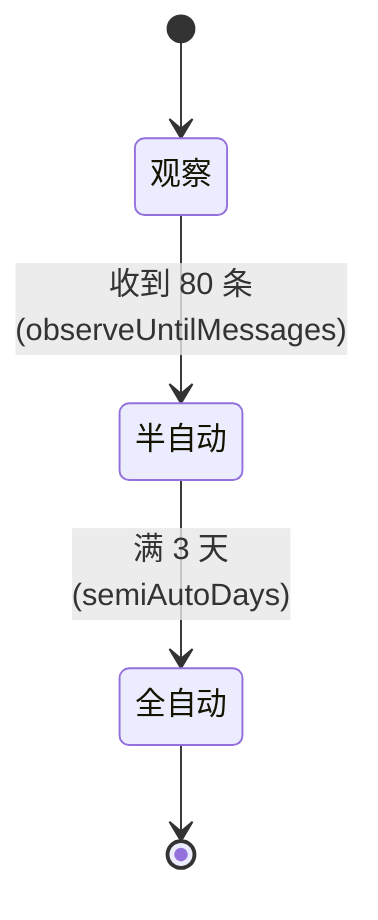
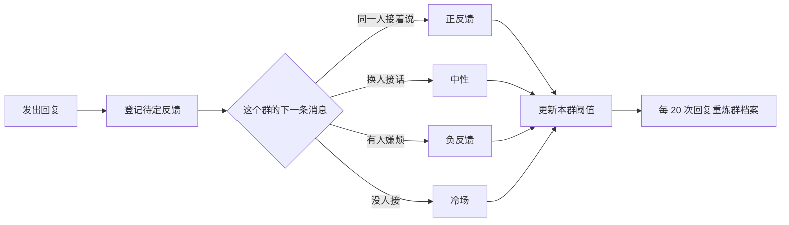

# 架构与实现

> 面向想改代码或想搞懂它怎么想事的人。全部数值都是**默认值**，配置端里可改。

## 目录

- [进程与分层](#进程与分层)
- [判定链路](#判定链路)
- [开口阶段机](#开口阶段机)
- [三路刹车](#三路刹车)
- [合并与分条](#合并与分条)
- [表达层](#表达层)
- [学习层](#学习层)
- [DSH 集成与前缀缓存](#dsh-集成与前缀缓存)
- [存储契约](#存储契约)

---

## 进程与分层

一个 Node 进程 + 一个本地 HTTP 配置端，**零 npm 依赖**。

```
app/main.js
  ├─ src/onebot.js        接入层：WebSocket 客户端、动作调用、事件归一化、去重
  ├─ src/runtime.js       运行时：合并 → 判定 → 阶段机 → 刹车 → 预算 → 表达 → 反馈
  ├─ src/classify.js      判定中枢：六因子 → p_say
  ├─ src/audit.js         二判通道（独立 profile）
  ├─ src/search.js        搜索通道（可切社区插件）
  ├─ src/brain.js         大脑调用与 profile 生成
  ├─ src/webui.js+webui/  配置端（9 页，原生 HTML/CSS/JS）
  └─ src/store.js         落盘（原文不落）
```

所有外部副作用（`send` / `askBrain` / `now` / `rng` / `store`）**都可注入** —— 这是 169 项测试能跑得又快又稳的原因。

## 判定链路

每条群消息先过**硬触发**（@我 / 点名 / 回复我 / 私聊），命中就直接送大脑。否则：

### 六因子

| 因子 | 含义 | 权重 |
|---|---|---|
| `hard` | 是否硬触发 | — |
| `semantic` | 语义上是不是在问东西 | w1 = 0.40 |
| `continuity` | 跟上一轮话题的连续性 | w2 = 0.20 |
| `need` | 是不是个真需求 | w3 = 0.25 |
| `cost` | 成本惩罚（λ = 0.5） | w4 = 0.15 |

加权求和得到 **p_say**（话用值）。

### 三个阈值

| 阈值 | 默认 | 作用 |
|---|---|---|
| 开口阈值 `utilitySpeakAt` | **0.20** | 低于它：本地判否，**一个字都不发** |
| 常规线 `utilityTerseAt` | **0.35** | 到它：短评档 |
| 多讲线 `utilityDetailedAt` | **0.65** | 到它：详细档 |

### 灰区

`[greyLo, greyHi]` 默认 **0.40 ~ 0.75**（上界会按本群反馈自适应）：

- 灰区 **上界以上** → 直接放行
- 灰区 **内部** → 送**二判**（独立一次调用，8 秒超时 → 不确定）
- 二判说"否/不确定"时，再看 p_say 够不够走**本地短答**（不走模型，零成本）

### 三档深浅

`depthChars` 默认 `[20, 60, 200]`（短评 / 总结 / 详细）。
详细档**一律不配图**。

## 开口阶段机

每个群独立一份状态：



| 阶段 | 行为 |
|---|---|
| **观察** | 只判定、**一个字都不发**。样本全进标注队列供标定 |
| **半自动** | 只回被点名/@/回复的 |
| **全自动** | 能在感兴趣的话题上主动插一句 |

`stageMode` 可设 `auto`（默认，按上面的规则）/ `observe`（强制观察）/ `live`（强制实际发送）。

## 三路刹车

| 刹车 | 怎么触发 | 谁可以 |
|---|---|---|
| **群内指令** | `/停 [分钟]` `/开` `/状态` | 群主 / 管理员 / 白名单 |
| **配置端暂停** | 状态页「全局停用」 | 管理员 |
| **停止文件** | 安装目录放一个 `STOP` 文件 | 任何人（拿不到电脑也能停） |

三条是**或**的关系，任一命中就整体停。

## 合并与分条

- **合并**：`coalesceWindowMs` 默认 **6000ms** —— 同一个人连发几条并成**一轮**判定，只回一次，避免被一句话刷屏
- **分条**：回复按句号拆，`maxSegments` 默认 **3** —— 像人一样一条条发，条间有停顿
- **超字数**：`overflow` 可选「压缩成一条」或「拆两条」

## 表达层

大脑在正文末尾写标记，运行时摘掉标记再发正文：

| 标记 | 触发 | 默认 |
|---|---|---|
| `[表情: 描述]` | 配表情包（按情绪标签 + 关键词检索） | 开（`memeFreq` = 少） |
| `[语音: 内容]` | Windows SAPI 合成 wav → OneBot `record` 段 | 关 |
| `[立绘]` / `[立绘: 幼年]` | 发当前形态的角色立绘 | 开 |
| `[图表: PNG 路径]` | 发 archify 画的图，**默认发完删本地** | 开 |

标记解析都是纯函数（`parseMeme` / `parseVoiceTag` / `parseIllustration` / `parseChart`），所以好测。

## 学习层



- **反馈归因**：靠"有没有人接着说 / 换人 / 嫌烦 / 冷场"推断，不需要人标注
- **bandit**：按群独立调阈值（上界在 0.30~0.85 之间自适应）
- **群档案**：每 20 次回复重炼一次（常聊话题 / 反感话题 / 说话习惯 / 节奏 / 活跃时段），管理员能在「群档案」页直接手改
- **标注回流**：观察期的样本进队列，人工标 30 条后回流做一次标定

## DSH 集成与前缀缓存

**这是省钱的关键。** 大脑不是自己调的 API，而是让 DSH 跑一个 profile：

```
app/dsh-home/profiles/qq-brain/
  cordis.patch.yml      人设 → personaPrefix（三档共用，逐字节相同）
  tier-low.patch.yml    agent-default-model.config.reasoningEffort = off
  tier-mid.patch.yml    low
  tier-high.patch.yml   high
  package.json · cordis.yml
```

调用形状：

```bash
dsh --profile qq-brain --patch tier-mid.patch.yml headless --json "<本轮任务>"
```

**为什么是一个 profile + 三档补丁，而不是三个 profile**：人设前缀在三个 profile 里会是三份各自独立的脚手架，缓存各算各的；
一个 profile + 三档补丁时，人设那段**逐字节相同**，DeepSeek 的前缀缓存可以**跨档命中**。实测 **94.0% / 96.1%**。

其余侧通道各有自己的 profile，人设互不干扰：

| profile | 用途 | 人设 |
|---|---|---|
| `qq-brain` | 回复本体 | 群小助手人设（默认全局人设 / 可整段覆盖） |
| `qq-audit` | 二判 | 只输出 是/否/不确定 的 rubric |
| `qq-search` | 搜索摘要员 | 只输出 ≤500 字要点 |
| `qq-vision` | 识图 | 只输出画面描述 |

**这些 profile 全在 `app/dsh-home` 里，一行都不写你的 `~/.dsh`。**

## 存储契约

| 文件 | 内容 | 上限 / 策略 |
|---|---|---|
| `config/app.json` | 全部配置（59 个字段） | 明文，可手改 |
| `config/secrets.json` | API Key | **gitignored**，永不回给前端 |
| `logs/bot.log` | 运行日志 | 滚动 |
| `data/observe.jsonl` | 判定记录（**只存关键词与统计，不存原文**） | 按天分片 |
| `data/profiles/g-<群号>.json` | 群档案 | 每群一份 |
| `data/labels.jsonl` | 标注队列（≤40 字摘要） | 满 30 条回流 |
| `data/voice/` `data/brain/images/` | 语音 wav / 下载的图片 | 可随时清空 |

**群与群之间状态隔离**：阶段、阈值、群档案、反馈统计全部按 `gid` 分开，一个群被调坏了不影响别的群。
