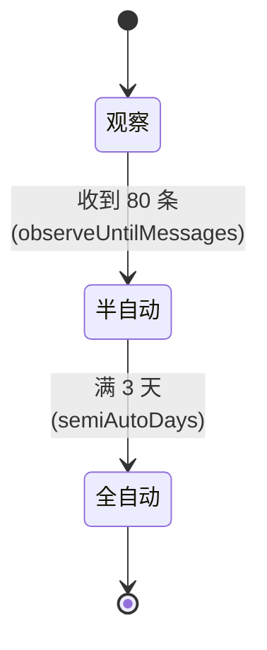
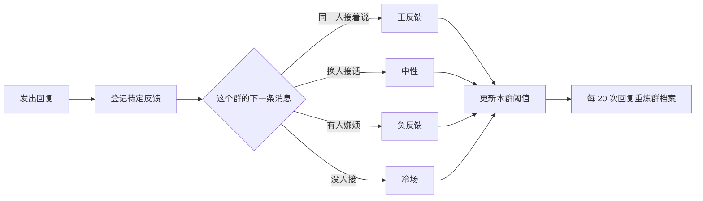

# 架构与实现

> 面向想改代码或想搞懂它怎么想事的人。全部数值都是**默认值**，配置端里可改。

## 目录

- [进程与分层](#进程与分层)
- [判定链路](#判定链路)
- [开口阶段机](#开口阶段机)
- [三路刹车](#三路刹车)
- [合并与分条](#合并与分条)
- [表达层](#表达层)
- [学习层](#学习层)
- [DSH 集成与前缀缓存](#dsh-集成与前缀缓存)
- [存储契约](#存储契约)

---

## 进程与分层

一个 Node 进程 + 一个本地 HTTP 配置端，**零 npm 依赖**。

```
app/main.js
  ├─ src/onebot.js        接入层：WebSocket 客户端、动作调用、事件归一化、去重
  ├─ src/napcat.js        NapCat 对接：读它的 onebot11 配置，自动对齐地址与令牌（只在进程内）
  ├─ src/runtime.js       运行时：合并 → 判定 → 阶段机 → 刹车 → 预算 → 表达 → 反馈
  ├─ src/classify.js      判定中枢：六因子 → p_say
  ├─ src/audit.js         外审复核通道（独立 profile，是 / 短 / 否）
  ├─ src/search.js        搜索通道（可切社区插件）
  ├─ src/brain.js         大脑调用与 profile 生成
  ├─ src/localreply.js    低档本地短答：分场景分池 + 同群不重复（零成本那一层）
  ├─ src/uimessages.js    配置端消息表：每群 30 条上限，满了丢最旧，落盘
  ├─ src/webui.js+webui/  配置端（9 页，原生 HTML/CSS/JS）
  └─ src/store.js         落盘（原文不落）
```

所有外部副作用（`send` / `askBrain` / `now` / `rng` / `store`）**都可注入** —— 这是 223 项测试能跑得又快又稳的原因。

## 判定链路

### 先分清两个量：`pSay` 管"回不回"，`U` 管"说多深"

| 量 | 怎么来 | 谁用它 | 决定 |
|---|---|---|---|
| `pSay`（开口概率） | `addressee.judge` 六因子加权 → sigmoid；疑似注入指令时 ×0.5 | `valve(pSay, bounds)` | **verdict**：no / grey / yes |
| `U`（这次回复的净值） | `benefit − 成本惩罚`（见下） | `depthTier(U, tiers)` | **tier**：low / mid / high |

两者互不代替：`pSay` 决定该不该开口，`U` 决定这句话值不值得说长。

### 六因子与 U

| 因子 | 含义 | 权重 |
|---|---|---|
| `pSay` | 该不该回（上一节的量） | w1 = 0.40 |
| `semantic` | 语义上是不是在问东西 | w2 = 0.20 |
| `continuity` | 跟上一轮话题的连续性 | w3 = 0.25 |
| `need` | 是不是个真需求（提问 / 求详） | w4 = 0.15 |

```
benefit  = (w1·pSay + gate·(w2·semantic + w3·continuity + w4·need)) + 0.10·topicDepth
costTerm = λ · diff · (cost / costScale)      λ=0.5；cost 按档位估算；costScale 取最近反馈的平均成本
U        = benefit − costTerm
```

`gate` 由硬触发强度映射（0.15~0.5，灰区时抬到 ≥0.5）。
**成本项和"要求越详细"正相关** —— 一句"展开说说"会让 estOut 变大、U 更负，
所以只看 U 会出现"越要求详细越只配短句"的反转，得靠下面的**深度地板**兜住。

### 三个阈值（分档线，配 `U`）

| 阈值 | 默认 | 作用 |
|---|---|---|
| `utilitySpeakAt` | 0.15 | 低于它：只配本地短句 |
| `utilityTerseAt` | **0.20** | **到它才进中档（走大脑）**；必须 ≥ speakAt，否则这条线永远走不到 |
| `utilityDetailedAt` | 0.65 | 到它：高深度（`reasoningEffort=high` + 外审一次） |

### 深度地板（语义明确的三种情况，不许被成本压成敷衍短句）

| 情况 | 结果 |
|---|---|
| 被点名 **且** 要求展开 | high |
| 要求展开（未点名） | 至少 mid |
| 被点名（@ / 回复我 / 叫名字） | 至少 mid |
| 明确问句 | 至少 mid |

### 灰区（配 `pSay`，不是配深度）

`[greyLo, greyHi]` 默认 **0.40 ~ 0.75**（按本群反馈自适应，步长 0.02，每 20 条回复调一次）：

| `pSay` | verdict | 后果 |
|---|---|---|
| < `greyLo` | no | 一个字都不发（`ignore`，但会试一次主动搭话） |
| 灰区内 | grey | 进下一步分档 |
| > `greyHi` | yes | 进下一步分档 |

**硬触发地板**：判 no 但有 @ / 回复我 / 叫名字 → 抬成 grey（至少回一句短的）。

### 语义补救与注入拦截（规则层，零成本）

本地 `pSay` 天生偏低（没人 @ 它，六因子里还压着成本），"值得回的话"很容易在开口那一关就被切掉，
连外审都看不到。所以先用两条规则开出口子：

| 规则 | 条件 | 结果 |
|---|---|---|
| **语义补救** | verdict=no、不是跟别人说话/转述/否定我，且像个真问题（问句 / 求详 / 话题深度 ≥ 2） | 抬成 grey；按 `gates.rescueAsk`（默认「中档」）决定要不要给中档地板（进大脑） |
| **注入拦截** | 命中「忽略以上内容」「你现在是」等注入话术 | 直接不回、也不送大脑（`gates.blockInjected`，默认开）；关掉则退回"概率减半" |

### 进中档（花钱）必须有「语义理由」

`U` 只是净值估算：它算得出"值不值得花这个钱"，算不出"这句话是不是在跟小助手说话"。
24 条模拟真实情景（指代不明 / 人称代词混用 / 长短悬殊）实测：光靠 `U ≥ 常规线` 会把
**单符号、劝架、对着别人说话、纯情绪话**都送进大脑（8/24 条）。所以进中档加了理由门：

| 情况 | 结果 |
|---|---|
| 点名 / 回复我 | 深度地板已抬到中档 ✓ |
| 点名但只是寒暄（"小肥鱼在吗"，且无实义词） | **压回低档 → 本地短答**（"在的～咋啦？"，零成本） |
| 没点名，但有求详 / 提问 / 被补救 / **上下文延续** | 保持中档 |
| 没点名，只是 `U` 过线 | **压回低档 → 本地短答** |
| 单字符 / 纯标点 | 直接不回（灌水拦截） |

### 外审不可用时，别把本地判断一起吞掉

超时、认证失败、通道不通都会发生（实测：`secrets.json` 里的 key 失效时，
外审每条都返回"不确定 + error"）。这时**沿用本地判断**，只有外审真的给出
"是 / 短 / 否"才按它的结论改档。否则一次 key 过期，整条复核路径就静默失效。

### 外审复核（同时定「该不该回」和「该说多长」）

外审不再只审高档，而是**按不确定度择机复核**；输出也从两档变成**三档**：

| 外审说 | 档位 / 动作 |
|---|---|
| 是 | 认真回：low → mid（该展开就抬上去） |
| 短 | 压到 low → 本地短句池（一句就够） |
| 否 | **真的不回**（verdict=no）—— 外审问的就是"值不值得开口"，判否就该闭嘴 |
| 不确定 / 超时（`audit.timeoutMs` 默认 8s） | 默认**降档**：灰区高档 → 中档；补救回来的 → 放弃这次。可配 `audit.onTimeout=保持` |

触发范围 `audit.scope`：

| 取值 | 审谁 |
|---|---|
| 只审高档（旧行为） | 只有 tier=high |
| **高档+复核救回（默认）** | 高档，加上被"语义补救"抬起来的那种（本地本来判否，是规则救的，拿不准必须复核） |
| 灰区也审 | 再加"本地灰 + 中档"（判得更准，代价是每条多一次调用与延迟） |

- `audit.auditUnaddressed`（默认开）：**没点名、但本地准备进大脑**的也先过外审 ——
  "你 / 他 / 她"到底指谁，本地规则分不清（实测"你这周有空吗，陪我去看个电影"就是靠它拦下来的）
- 限额 `audit.maxPerHour`（默认 30，0=不限）：防止灰区全审把额度和延迟堆起来
- 超时/失败一律**不确定**，绝不因为外审坏了就乱判；结果回流：`auditAgreed/auditCalled` → 翻转率 → `adaptBounds` 调 `greyLo / greyHi`
- `gates.rescueAsk=短句` 时，外审的"是"也不会把这一条抬成中档（用户政策优先）

### 人设里的"能力声明"必须和真做得到的事一致

人设里写了什么，模型就会照着演。所以**写进人设的能力，都要先问一遍"这台机器真做得到吗"**：

| 能力 | 判定依据 | 做不到时怎么写 |
|---|---|---|
| 看图（识图） | `runtime.vision.capable`（自动 / 有 / 无）：**模型默认「同大脑」**（与大脑同一个模型，显式选择 → 按有视觉处理）；填具体模型 id 时才按模型名认，认不出就当没有 | 写【看不到图】：收到 `[图片]` 就直说看不到、让对方描述 |
| 发音（TTS） | `runtime.voice.enabled` + Windows SAPI + 本机音色列表里有这个音色 | 不写【语音】；音色名写错会记一条"退回国语默认音色"的提示 |
| 听语音（转写） | 本程序**不做转写**（常量） | 写【听不到语音】：让对方打字 |

判定结果会打进启动日志（`能力声明 · 看图：…　发音：…`），一眼能看出人设里到底声明了什么。

**识图默认走大脑模型**：`runtime.vision.mode=dsh` + `runtime.vision.model=同大脑`（默认值）时，识图跑在 `qq-vision` profile 里，
模型解析与大头脑完全一致（OFM 插件开着就同一个 provider/model，否则都用 DSH 默认模型）。
图片以「绝对路径」进提示词，由 agent 自己读图 —— 实测同一张立绘 **6.9 秒**出描述。
拿到描述后拼进本轮上下文；**一条都没拿到时**，正文里会补一句"图片没拿到内容，不要假装看到了"，防止模型顺着编。

### 引用 / 戳一戳 / 识图前置（接收与表达的新能力）

**引用（reply）** —— 以前只拿它判"是不是回复我"，原文根本没读；现在两头都通了：

| 环节 | 做法 |
|---|---|
| 读 | reply 段自带原文就直接用；没有就用 `get_msg` 取（**10 分钟缓存**，同一条被反复引用只查一次；取不到就按没有引用处理，**绝不编**） |
| 融入判定 | 原文拼成前缀 `[引用 甲：原文]` 进正文 → **本地一判就能看懂**（"对"这种答复不再是无意义文本），也进大脑、也进配置端消息表 |
| 用 | 大脑写 `[引用]` 标记，或**对方本来就是在用引用接话**时 → 这条回复做成引用回复（`reply` 段排在 text 段前）；高档长回答不引用（像客服）。开关 `runtime.quoteReply` = 关 / **自动** / 仅标记 |

**戳一戳（poke）** —— 以前 `post_type !== "message"` 直接丢，戳她毫无反应：

- 归一化：`notice_type=notify & sub_type=poke`（go-cqhttp / NapCat）与 `notice_type=poke` 两种形状都认；`normalizeNotice()` 返回 `{kind:"poke", pokeMe}`。
- 只回应**戳她**的；群里别人互戳不插手；自己戳的不理。
- 反应**零成本**：专用短答池（"干嘛～"/"别戳了"/"戳我干嘛"…）+ 按 `runtime.pokeBackRate`（默认 0.35）回戳（先 `group_poke`，失败退 `send_poke`，再失败退化成短答）。
- **限流**：同一个人 `runtime.pokeGapSec`（默认 60 秒）内只反应一次 —— 防止和人对戳刷屏。
- **不进判定中枢**：戳不是消息，不吃观察期/预算那套；被刹车（STOP / 停用 / 关群）时照样不吭声。

**识图前置** —— 修掉一个真 bug：识图原来在**合并之后**才注入，纯图片消息在本地就被当"无意义文本"判否，
识别结果白花钱、**配置端也看不到识别文本**。现在：

- 识别挪到**逐条判定之前**，描述拼进正文 → 本地一判看得到画面、配置端消息表也显示描述；
- **同一张图 10 分钟内只识别一次**（`visionCache`，按 file/url 键）—— 群里常有人反复发同一张图；
- 进大脑的正文用"判定时那份"（含引用原文 + 识图描述），历史与消息表同步富化；
- **语音（可选）：本机 STT 侧车**（tools/stt-server.py）把音频转成文字，打同一种 【[语音] 转写：…】 标签，**判定之前**拼进正文 —— 所以它跟识图一样能参与本地一判；同一段音频 10 分钟只转一次。原来的说明已过时：语音仍不做转写：没有 STT 就继续写【听不到语音】，要真听懂得另接一个 STT 通道（未接）。

新增配置项：`runtime.quoteReply` / `runtime.poke` / `runtime.pokeBackRate` / `runtime.pokeGapSec`。

### 搜索闸门（N22：什么时候才该搜）

以前只要「中档 + 有关键词」就搜 —— 而中文关键词是从整句切出来的 2 字 n-gram，
于是**闲聊也会搜**：实测 126 条判定里 58 条要搜，「无敌了」「我去调调」这种都被拿去搜了一遍，
一次搜索约 5 秒还会拖慢回复（群里当时就在抱怨「这搜索回复也太慢了」）。

现在要**两件事同时成立**才搜：

| 条件 | 说明 |
|---|---|
| ① 真有信息需求 | 提问 ∨ 求详，**并且**问的是会变的东西（今天/最新/几点/价格/版本/链接…）或句子里有链接；用户明确说「搜一下」则必搜 |
| ② 检索词像话 | 去掉口语废词（我去/好像/确实/无敌…）、纯数字、以及**整词全由废词拼出来**的词（「我去调调」）；长词优先 |
| 低档 | 永远不搜（本地短答，0 成本） |

不搜时提示词里会明确写「凭已有知识回答，不要编造实时信息」，防止它硬编。

### 引用回复：按「是否明确指向」用，不按长短

实测 49 条回复里**一次引用都没用**（功能等于死的）：原来只有「对方用引用发来」或「模型主动写 [引用]」才触发，
而最典型的明确指向 —— **@ 她** —— 反而不引用。改成只问一件事：**这条是不是在明确回某个人/某一条**。

| 情形 | 是否引用 |
|---|---|
| 被 @ 触发（@ 就是最明确的指向） | **引用**触发她的那条 |
| 对方本来就是用引用发来的（在接某条线） | **引用**回去 |
| 大脑主动写了 [引用]（想针对更早的某条） | **引用**那条 |
| 自己陈述、闲聊接话、跟大家讨论、主动搭话 | **不引用**，直接发言（每条都引用像客服） |

开关 runtime.quoteReply：关 = 从不引用；**自动** = 上面三种；仅标记 = 只听模型的。
程序侧会在 sent 与后台消息表里标 quote:true，方便核对到底有没有用起来；人设里也把「什么时候用 / 别用」写清了。

### 话题词条的生命周期（临时起意会过期，持续稳定的才固化）

原来群档案的兴趣词条是「并集 + slice」：**旧词永远粘住、新词被挤掉**（只会加不会删），
于是实测档案里攒的是「是什么 / 给小 / 看史」这种一次性的碎片，长期话题反而进不来。

现在每个词都带证据（命中次数 / 跨了几天 / 首次 / 最近一次），按证据分三段：

| 阶段 | 条件 | 去留 |
|---|---|---|
| 观察区 | 刚学到（还没达标） | **不写进提示词**；interestWatchDays（默认 3）天没再被聊到就清掉 |
| 固化 | 累计命中 ≥ interestStableHits(4) **且** 跨 ≥ interestStableDays(2) 天 | 写进【本群兴趣词条】，按命中次数排序，最多 interestMax(8) 条 |
| 沉寂降级 | 固化后 interestStableKeepDays(21) 天没再被聊到 | **先降级回观察区**，不直接删（防回潮误伤）；再沉寂才清 |

- 管理员在配置端**手写**的话题一律钉住（pinned）：不降级、不淘汰；老档案里 updatedBy=admin 的也自动钉住。
- 每次提炼都记 interestLog（added/promoted/demoted/dropped + 当前固化与观察区），排查「这词为什么不见了」直接看它。
- 提示词里只放**固化**的词：观察区换来换去，放进去会破坏前缀缓存。

### 大脑思考强度（三档可调，之前是死的）

三档走的是「一个 profile + 三个 overlay 补丁」：补丁只改模型调用参数、不碰人设，
所以 personaPrefix 在三档之间字节一致，前缀缓存可以跨档共享。

| 配置项 | 默认 | 说明 |
|---|---|---|
| brain.effort.low | off | 短评档（本地短答一般不进大脑） |
| brain.effort.mid | low | 总结档，平时用的就是它 |
| brain.effort.high | high | 详细档 |

- 取值 off / low / medium / high；改完保存**立刻重写** tier-*.patch.yml（不用重启）。
- 走免费模型（Our Free Model）时自动**去掉**这个字段：免费池的模型大多不认，传了会直接报错。
- **修复**：以前 askBrain 只把 promptText 传下去，档位补丁根本没进命令行 —— 于是「思考强度」怎么配都不生效。
  现在按当轮档位把 tier-<tier>.patch.yml 用 --patch 真的传进去。

### 大脑 API Key 填在哪（新人最容易卡住的一步）

- 首选：配置端 →「接入」→「**大脑 API Key（DeepSeek）**」粘贴，保存即写进 app/dsh-data/config/secrets.json（只存本机、界面只显示遮蔽值）。
- 也可以：直接编辑 app/dsh-data/config/secrets.json 里的 deepseekApiKey；或设环境变量 DEEPSEEK_API_KEY。
  优先级：工作区文件 > 环境变量。
- **通道 ≠ 凭据**：程序是借 DSH 这条通道发请求，但用的是**你自己的 key**，不会复用桌面版 DSH 的凭据。
  注意别把 key 填进 brain.dshCliPath（那是 DSH 启动器路径）。
- 想 0 成本：设置页「免费模型」→ 检测 → 勾「大脑走免费模型」。

### 提示词装配顺序（缓存优先级，默认生效）

人设全文在 `personaPrefix`（system prompt）里，永远排最前。**每轮消息体**按"少变在前、易变在后"排：

| 顺序 | 块 | 变化频率 | 为什么放这里 |
|---|---|---|---|
| ① | 本群专属人设（管理员手写）+【本群画像】（说话习惯 / 备注 / 节奏 / 活跃时段） | 每 refN 次提炼才变 | 最稳定，先吃缓存前缀 |
| ② | 【本群兴趣词条】（常聊话题 / 少碰话题） | 提炼时容易翻，且**直接影响主动搭话** | 比画像易变，但比"本轮任务"稳 |
| ③ | 【本轮任务】（档位 / 字数上限 / 搜索摘要） | 每轮都变 | 易变，往后放 |
| ④ | 【群里的上下文（越靠下越新）】 | 每轮必变 | 最易变 |
| ⑤ | 本轮图片描述 | 有图才出现 | 最末 |

**为什么拆开**：以前【本群画像】把"说话习惯 / 节奏"（少变）与"常聊话题"（多变）混在一块，
兴趣词条一翻，后面的"本轮任务"也跟着重算 —— 现在画像与兴趣词条分成两块、各就各位；
主动搭话那条路（`tryProactive`）用同一套顺序。

> 全局人设内部同理：稳定段（身份 / 性格 / 说话方式 / 形象）在前，可变段（表情包 / 立绘 / 图 / 语音）在后 —— 见下一节。

### 人设的"稳定段 + 可变段"结构（前缀缓存的前提）

人设全文放在 `personaPrefix`，是唯一字节稳定、能吃满前缀缓存的位置。所以它按**两段**组织：

| 段 | 内容 | 随开关变吗 |
|---|---|---|
| **稳定段**（前） | 身份内核 / 性格 / 说话方式 / 形象（固定外形）/ 听不到语音 / 群里的人 / 安全底线 | 不变 |
| **可变段**（后） | 当前形态 / 表情包 / 立绘（图片）/ 语音 / 画图（图表）/ 看图（或看不到图）/ 只能发文字 | 随配置开关变 |

表达层这几个块都是**可变功能**，一一对应可关的开关：

| 人设里的块 | 开关 | 关掉之后 |
|---|---|---|
| 【表情包】 | `plugins.meme` + `persona.memeFreq` | 人设里不提配图，模型不会写 `[表情: …]` |
| 【立绘（图片）】 | `plugins.illustration`（默认开） | 不提立绘，程序也不发（`[立绘]` 标记会被忽略） |
| 【画图】 | `plugins.archify` | 不提画图，`[图表: …]` 不转图 |
| 【语音】 | `runtime.voice.enabled` + 本机音色 | 不提语音，`[语音: …]` 不合成 |
| 【看图】/【看不到图】 | `runtime.vision.enabled` + 模型视觉能力 | 写【看不到图】，收到 `[图片]` 直说看不到 |

**"什么时候发"由模型自己判断**，人设只给"时机 + 节制"（"什么时候发由你判断…"），
程序只做兜底：高档不配图、`memeFreq=少` 要隔几次回复、开关关掉一律不发。

开一个开关只让"尾巴"变化，前面的前缀照样命中缓存 —— 这就是把"会变的东西"全放最后的唯一原因。

### 三档深浅（`depthChars` 默认 `[20, 60, 200]`）

| 档位 | 调大脑 | 模型发力 | 搜索 | 字数上限 | 上下文 |
|---|---|---|---|---|---|
| low | 否（本地短句池） | — | 0 | 20 | 0 |
| mid | 是 | `reasoningEffort=low` | ≤1 次（有关键词才搜） | 60 | 10 条 |
| high | 是 | `reasoningEffort=high` | 1 次 | 200 | 10 条 |

详细档**一律不配图**。三档字数由 `gates.depthChars` 一处配置，分档流水与大脑提示词共用同一份。

#### 低档本地短答：分场景 + 同群不重复

低档那一句是**零成本**的，但它最容易翻车：实测群里 `sent` 全是 `嗯？/咋了/啥事/在的` 在循环，
用户的原话是「**只会嗯嗯啊啊说是**」。所以本地短答有三条硬规则：

| 规则 | 做法 |
|---|---|
| **分场景** | 寒暄 → 应答型（"在的～咋啦？"）；被点名 → "在的，你说"；情绪宣泄 → "咋了？又崩了？"；各 bucket 各一套 |
| **图片 / 语音说实话** | 文本里出现 `[图片]` / `[语音]` 就直接回"图我这边没看到内容，你描述下？"/"语音我听不了，打字吧" —— 不拿"嗯？"糊弄 |
| **同群不重复** | 每群记住最近 6 条（落盘 `data/data/localreplies.json`），池子没说完之前不许重复；换群互不影响 |

### "回不回"的完整闸门顺序

```
刹车（STOP 文件 / 配置暂停 / 群内 /停）   → 停
管理指令（/状态 /停 /开 …）                → 指令回复
   ↓ 合并窗口（coalesce）
本地判定（valve→verdict，U→tier，含深度地板与外审）
   ↓
verdict=no（且无硬触发）                   → ignore（仍会试一次主动搭话）
   ↓
预算 allowReply（超硬顶且没点名）           → budget_block
   ↓
观察期 observe                              → observe_only（一个字都不发，判否的也留档）
   ↓
半自动 semi 且非硬触发                      → semi_skip
   ↓
每群每小时上限 groupHourlyLimit（默认 0 = 关）→ group_limit
   ↓
local_short（本地短句池，零成本） / brain（按档位调模型）
```

**主动搭话**是唯一的例外路径：只在全自动阶段、预算 normal、话题撞上兴趣时走，
且它**仍会调一次大脑**（low 策略、≤20 字、不许问号收尾），受 `autojoin.*` 节流。

## 开口阶段机

每个群独立一份状态：



| 阶段 | 行为 |
|---|---|
| **观察** | 只判定、**一个字都不发**。样本全进标注队列供标定 |
| **半自动** | 只回被点名/@/回复的 |
| **全自动** | 能在感兴趣的话题上主动插一句 |

`stageMode` 可设 `auto`（默认，按上面的规则）/ `observe`（强制观察）/ `live`（强制实际发送）。

## 三路刹车

| 刹车 | 怎么触发 | 谁可以 |
|---|---|---|
| **群内指令** | `/停 [分钟]` `/开` `/状态` | 群主 / 管理员 / 白名单 |
| **配置端暂停** | 状态页「全局停用」 | 管理员 |
| **停止文件** | 安装目录放一个 `STOP` 文件 | 任何人（拿不到电脑也能停） |

三条是**或**的关系，任一命中就整体停。

## 合并与分条

- **合并**：`coalesceWindowMs` 默认 **6000ms** —— 同一个人连发几条并成**一轮**判定，只回一次，避免被一句话刷屏
- **分条**：回复按句号拆，`maxSegments` 默认 **3** —— 像人一样一条条发，条间有停顿
- **超字数**：`overflow` 可选「压缩成一条」或「拆两条」

## 表达层

大脑在正文末尾写标记，运行时摘掉标记再发正文：

| 标记 | 触发 | 默认 |
|---|---|---|
| `[表情: 描述]` | 配表情包（按情绪标签 + 关键词检索） | 开（`memeFreq` = 少） |
| `[语音: 内容]` | Windows SAPI 合成 wav → OneBot `record` 段 | 关 |
| `[立绘]` / `[立绘: 幼年]` | 发当前形态的角色立绘 | 开 |
| `[图表: PNG 路径]` | 发 archify 画的图，**默认发完删本地** | 开 |

标记解析都是纯函数（`parseMeme` / `parseVoiceTag` / `parseIllustration` / `parseChart`），所以好测。

## 学习层



- **反馈归因**：靠"有没有人接着说 / 换人 / 嫌烦 / 冷场"推断，不需要人标注
- **bandit**：按群独立调阈值（上界在 0.30~0.85 之间自适应）
- **群档案**：每 20 次回复重炼一次（常聊话题 / 反感话题 / 说话习惯 / 节奏 / 活跃时段），管理员能在「群档案」页直接手改
- **标注回流**：观察期的样本进队列，人工标 30 条后回流做一次标定

## DSH 集成与前缀缓存

**这是省钱的关键。** 大脑不是自己调的 API，而是让 DSH 跑一个 profile：

```
app/dsh-home/profiles/qq-brain/
  cordis.patch.yml      人设 → personaPrefix（三档共用，逐字节相同）
  tier-low.patch.yml    agent-default-model.config.reasoningEffort = off
  tier-mid.patch.yml    low
  tier-high.patch.yml   high
  package.json · cordis.yml
```

调用形状：

```bash
dsh --profile qq-brain --patch tier-mid.patch.yml headless --json "<本轮任务>"
```

**为什么是一个 profile + 三档补丁，而不是三个 profile**：人设前缀在三个 profile 里会是三份各自独立的脚手架，缓存各算各的；
一个 profile + 三档补丁时，人设那段**逐字节相同**，DeepSeek 的前缀缓存可以**跨档命中**。实测 **94.0% / 96.1%**。

其余侧通道各有自己的 profile，人设互不干扰：

| profile | 用途 | 人设 |
|---|---|---|
| `qq-brain` | 回复本体 | 群小助手人设（默认全局人设 / 可整段覆盖） |
| `qq-audit` | 二判 | 只输出 是/否/不确定 的 rubric |
| `qq-search` | 搜索摘要员 | 只输出 ≤500 字要点 |
| `qq-vision` | 识图 | 只输出画面描述 |

**这些 profile 全在 `app/dsh-home` 里，一行都不写你的 `~/.dsh`。**

## 存储契约

| 文件 | 内容 | 上限 / 策略 |
|---|---|---|
| `config/app.json` | 全部配置（**72 个字段**） | 明文，可手改 |
| `config/secrets.json` | API Key | **gitignored**，永不回给前端；只经环境变量传给子进程 |
| `logs/bot.log` | 运行日志 | 滚动 |
| `data/observe.jsonl` | 判定记录（**只存关键词与统计，不存原文**） | 满 5000 行滚动 |
| `data/stages.json` | 分群阶段（含"手动跳过观察期"） | 改动即时落盘 |
| `data/budget.json` | 今日已用 token | 攒 1.5s 写；重启后日熔断照样有效（**一条回复到底花多少钱，见 [COST.md](COST.md)**） |
| `data/brakes.json` | 按群暂停（含配置端"关掉本群"） | 立即落盘 |
| `data/bandit-state.json` | 话风臂与学习状态 | 攒着写 |
| `data/localreplies.json` | 每群最近说过的本地短答 | **每群 6 条**，池子没说完不重复（防"嗯？啥事"复读） |
| `data/ui-messages.json` | 配置端「收到的消息与判定过程」 | **每群 30 条**（`runtime.uiMessageLimit` 可改），满了按时间丢最旧；最多 30 个群；卡片默认折叠 |
| `data/profiles/g-<群号>.json` | 群档案 | 每群一份 |
| `data/labels.jsonl` | 标注队列（≤40 字摘要） | 满 30 条回流 |
| `data/voice/` `data/brain/images/` | 语音 wav / 下载的图片 | 可随时清空 |

**群与群之间状态隔离**：阶段、阈值、群档案、反馈统计全部按 `gid` 分开，一个群被调坏了不影响别的群。

状态页把上面这份口径直接显示成**钱**：今日花费 / 平均每条回复 / 缓存命中率（含命中省下）/ 本地判断省下，外加日预算滑块与各群花费 —— 都在同一张「成本（今日）」卡片里，同类信息不散在多张卡；**卡片都做成可折叠**（开合状态记在本机）。计价表在 app/src/cost.js，实测数据与复算方法见 [COST.md](COST.md)。
