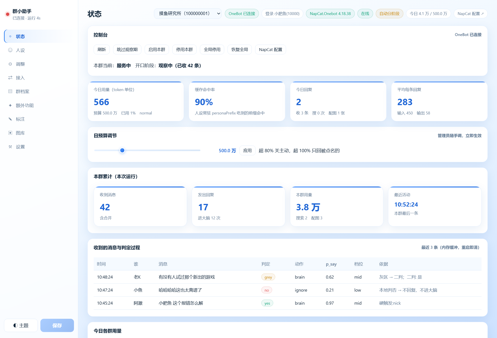
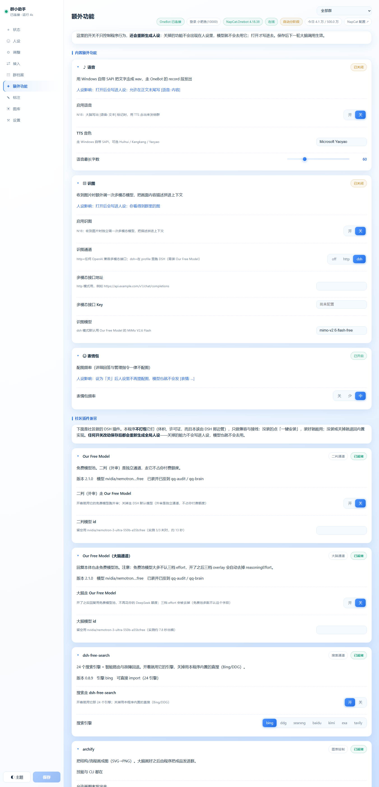
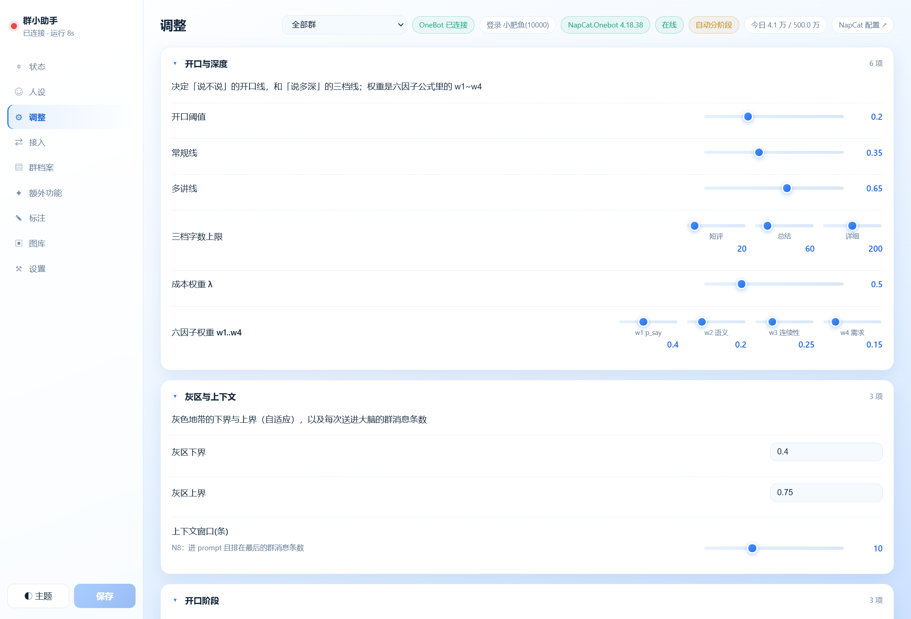
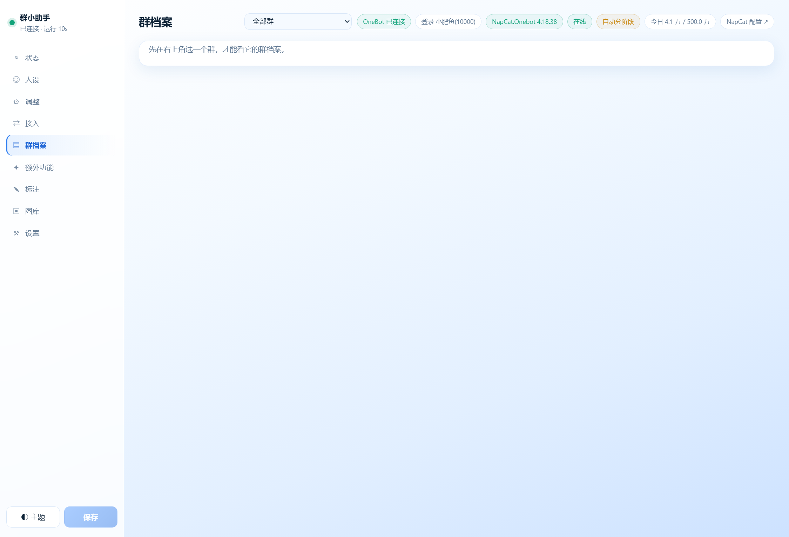
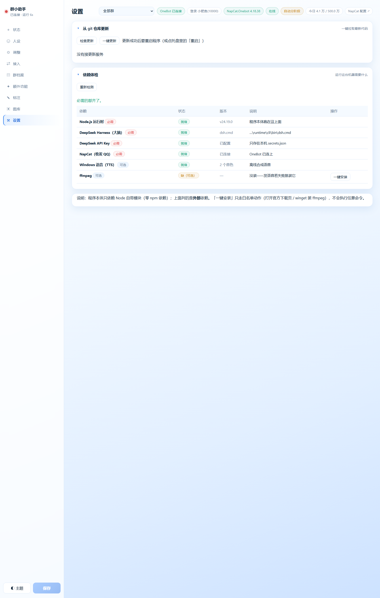

# B 站宣传视频制作说明

> 给做视频的人（可能就是你自己）看的工作文档。含**分镜脚本**、**素材清单**、**要现场录的操作**、**封面与发布文案**，以及几条**别踩的线**。

---

## 一、视频定位

| 项 | 建议 |
|---|---|
| **时长** | **3 分半 ~ 4 分半**。B 站技术区的甜点区；再长留不住人 |
| **受众** | ① 玩过 QQ 机器人 / OneBot 的人 ② 对「Agent 到底怎么用」感兴趣的人 ③ 想做自托管群助手的人 |
| **风格** | **冷静的技术流**，不是「震惊体」。这个项目最反直觉的卖点是**它不是有问必答** |
| **节奏** | 前 15 秒必须让人知道「哦，它会**自己判断该不该说话**」 |
| **口播 vs 字幕** | 建议**字幕为主 + 少量口播**（技术区观众多数 2 倍速看，字幕密度要够） |


*主视觉就用这张——它本身就是用项目自己的 archify 画的。*

### 标题候选

1. **「我做了个会自己闭嘴的QQ群机器人」** ← 推荐：反差感强、15 字内、卖点直给
2. **「让 AI 判断该不该说话：一个群聊助手的设计与账单」** ← 偏严肃，适合技术区深度向
3. **「不 @ 也能接话，但该闭嘴时一个字都不发」** ← 更抓人，但稍微抽象

> 别用「AI 群管」「智能群助手」这种词——同类标题太多了，会被淹。

---

## 二、三条核心卖点（每条都是现成字幕）

### 卖点 1：**它有「开口线」，不是有问必答**

每一条群消息先过**六因子**加权算出「话用值」，低于阈值就**一个字都不发**。
它不会像普通机器人那样「被 @ 就冒出来一段废话」——它像一个**有分寸的群友**。

> 字幕：*群里 90% 的话不是在跟它说。它先自己判断，判否就闭嘴——一分钱不花。*

### 卖点 2：**省钱的不是模型，是这一层判断**

流水线的前半段全是**本地算法**：合并 → 六因子 → 三阈值 → 灰区二判。**只有确定要回才调模型。**

> 字幕：*人设常驻系统提示词最前段，实测前缀缓存命中 94~96%。缓存读的价格约是输入价的十分之一。*

### 卖点 3：**它是「长」出来的，不是配出来的**

新群先**观察 80 条**只判定不发言 → 半自动 → 全自动；按「有没有人接着说」自学习，逐群调阈值、重炼群档案。

> 字幕：*新群前 80 条它只看不说——用真实群聊给自己做标定。*

---

## 三、分镜脚本

> 时间轴按 **4 分钟**排。括号里是**素材文件**，都在 `video/shots/` 或 `docs/diagrams/`。

| 镜 | 时间 | 画面 | 字幕 / 旁白 | 素材 |
|---|---|---|---|---|
| **1** | 0:00–0:12 | 黑底一句话淡入；切 QQ 群截图（**要打码**） | 「群里的 AI，最难的**不是回答，是判断该不该开口**」 | 现场录 |
| **2** | 0:12–0:30 | 架构图整体推入，缓慢左移 | 「它叫 dsh-qq-assistant。左边这一半**全是本地算法，一分钱不花**」 | `diagrams/architecture.png` |
| **3** | 0:30–0:55 | 判定链路动图（逐块点亮） | 硬触发 → 合并 → 六因子 → 三阈值 → 灰区二判 | README 的 Mermaid 图（GitHub 渲染后录屏） |
| **4** | 0:55–1:20 | **状态页**实拍：判定过程表滚动 | 「每条消息都被判成 yes / no / grey，**依据写得明明白白**」 | `video/shots/01-状态.png` + 现场录 |
| **5a** | 1:20–1:32 | 点状态页的**「跳过观察期」**，阶段从「观察中」变「全自动」 | 「新群默认只看不说。不想等 80 条？点一下这个按钮。」 | 现场录（见 @@shots/01-状态.png@@ 控制台那排） |
| **5b** | 1:32–1:45 | 鼠标划预算滑块，数字实时变 | 「管理员随手改当日预算，超 80% 关主动搭话，超 100% 只回被点名的」 | 现场录 |
| **6** | 1:40–2:05 | **额外功能页整页**下滑，停在【社区插件兼容】 | 「四个社区插件都能插能拔，**关掉的能力连人设里都不写**」 | `video/shots/02-额外功能-整页.png` |
| **7** | 2:05–2:30 | 真人操作：装插件 → 复制到人设 → 保存 | 「点一次一键安装，四个插件全装好」 | 现场录 |
| **8** | 2:30–2:50 | **架构图**局部放大（右边社区插件那圈） | 「免费模型、24 个搜索引擎、画图、图库——都不打包，只做兼容」 | `diagrams/architecture.png` |
| **9** | 2:50–3:15 | 终端跑测试，167 项全过 | 「167 项回归测试，9 项验收，**零 npm 依赖**」 | 现场录终端 |
| **10** | 3:15–3:40 | 机器人真画一张架构图发进群 | 「让它画个架构图——画完**发进群，本地不留文件**」 | 现场录 |
| **11** | 3:40–4:00 | 收回架构图全景 + 仓库地址 | 「开源在 GitHub，AGPL-3.0。**BYO key**，用你自己的额度」 | `diagrams/architecture.png` |

### 可选的笑点插入（放在 1:20 附近，10 秒）

真机日志截图：有人发了个逗号 `,` → 判定 **no / ignore / p=0.35** / 依据「本地判否 → 不回复、不进大脑」。

> 字幕：*有人发了个逗号。它看一眼：不理。* —— 这种小细节最容易出圈。

### 镜 4 / 镜 6 的画面长这样



*状态页。每条消息的判定、动作、p_say、档位、依据都在这一张表里——这是全片最有说服力的一屏。*



*额外功能页整页。上半是内置能力（语音 / 识图 / 表情包），下半是【社区插件兼容】四张卡。*

---

## 四、素材清单

| 文件 | 用途 | 备注 |
|---|---|---|
| `diagrams/architecture.png` | 主视觉、镜 2/8/11 | 3000×1800，**用 archify 画的真图**（不是示意图） |
| `diagrams/architecture.html` | 想要更炫：录它的**交互**（切深色 / 悬停高亮） | 浏览器打开即可，自带 Export 按钮 |
| `video/shots/01-状态.png` | 镜 4/5 | 合成数据，**无隐私** |
| `video/shots/02-额外功能-整页.png` | 镜 6 | 含【社区插件兼容】四张卡 |
| `video/shots/03-调整.png` | 补充 | 开口阈值 / 三档字数等参数 |
| `video/shots/04-群档案.png` | 补充 | 管理员手改群档案 |
| `video/shots/05-设置-整页.png` | 补充 | 依赖体检 + git 一键更新 |
| `video/shots/05-设置.png` | 补充 | 同上的首屏 |
| `../角色形象图/成年.jpg` `幼年.jpg` | 角标 / 转场 / 封面素材 | **作者保留权利**，见仓库 LICENSE 说明 |

> 所有截图都是**合成数据**（假昵称 `阿澈/小鱼/老K/小满`、假群号 `100000001`、假账号 `小肥鱼(10000)`），可以放心用。

### 其余素材预览



*调整页：开口阈值、三档字数、灰区上下界、预算熔断。*



*群档案页：管理员能直接手改从群聊里提炼出来的画像。*



*设置页：依赖体检 + 从 git 仓库一键更新。*

---

## 五、需要现场录制的操作（建议提前排练一遍）

1. **群聊实拍**（**必须打码**）
   - 发一条 `@机器人 这个报错怎么解` → 它回一句
   - 发一条 `哈哈哈哈` → 它**不回**（这就是卖点）
2. **配置端**
   - 状态页：滚动「收到的消息与判定过程」
   - 状态页：点**「跳过观察期」**（在「刷新」右边），阶段标签立刻变成「全自动」；再点「回到观察」可退回去
   - 拖「日预算调节」滑块 → 点应用
   - 额外功能页：开一个插件开关 → 保存 → 回人设页**指出人设变了**
   - 群档案页：改一个话题 → 保存
3. **终端**
   - `node test/run-tests.mjs` → 167 项全过
   - `node demo/run-acceptance.mjs` → 9/9
   - `node demo/run-chart-demo.mjs` → 13/13（图表管线）
4. **画图**（最出效果的一段）
   - 在群里说「画个系统架构图」
   - 等 10~20 秒，图出现在群里
   - 补一句字幕：「本地一个文件都没留」

---

## 六、封面

- **构图**：左边放 `../角色形象图/成年.jpg` 半身像（透明或浅底），右边放状态页的「判定表」局部
- **主标题**（大字）：**会自己闭嘴的** ／ **QQ 群机器人**
- **副标题**（小字）：六因子判定 · 前缀缓存 94% · 零依赖
- **配色**：跟配置端一致——白到浅蓝渐变 + 蓝 `#2f7ff0`，辨识度高
- 别把字压在人物脸上；B 站封面在手机端很小，**主标题至少占宽度的 60%**

---

## 七、剪辑与字幕规范

| 项 | 建议 |
|---|---|
| **字幕** | 每行 ≤ 18 字，两行以内；技术名词首次出现给全称 |
| **节奏** | 前 30 秒不放任何超过 3 秒的静止画面 |
| **BGM** | 轻电子 / lo-fi，音量压到人声的 20% 以下；技术区别用史诗向 |
| **转场** | 只用**切**和**淡入淡出**，别用旋转 / 翻页（显廉价） |
| **强调** | 关键数字（**94%**、**167 项**、**零依赖**）用同色放大字弹出 |
| **PIP** | 配置端操作建议**局部放大**（右下角画中画），否则手机上看不清 |

---

## 八、发布信息

### 简介（可直接抄）

```
群里 90% 的话不是在跟它说。所以我做了个会先判断「该不该开口」的 QQ 群助手。

· 六因子算出「话用值」，低于阈值一个字都不发
· 人设常驻系统提示词最前段，前缀缓存实测命中 94~96%
· 新群先观察 80 条只判定不发言，再转半自动 → 全自动
· 零 npm 依赖，167 项回归测试，9 项验收全过
· 四个社区插件（免费模型 / 24 引擎搜索 / 画图 / 图库）可插可拔，关掉的能力连人设里都不写

开源（AGPL-3.0）：https://github.com/wingbire/dsh-qq-assistant
BYO key：用你自己的 DeepSeek 额度；本项目不含任何人的密钥、也不代付任何费用。

#QQ机器人 #OneBot #DeepSeek #Agent #开源 #NodeJS
```

### 置顶评论

```
几个常见问题：
1. 它为什么不说话？新群默认「观察模式」，攒够 80 条才转半自动。想立刻看效果：调整 → 开口阶段 → stageMode 改 live
2. 要花多少钱？BYO key。省钱的不是模型，是前面那层本地判定（拦掉大部分消息）
3. 会上传我的群聊吗？没有遥测没有回传。原文不落盘，只存关键词与统计；凭据只在本机 secrets.json
4. 需要装什么？Node ≥22 + DSH + NapCat（推荐 NapCat.Shell，大小号天然隔离）

有问题评论区问，我尽量回。
```

---

## 九、几条别踩的线

> 这一节比上面都重要。

1. **群聊截图必须打码**：昵称、QQ 号、群号、群名，一个都别露。
   仓库里那套截图是**合成数据**（假名假号），可以直接用；**你自己录的真群画面必须先打码再发**。
2. **别吹过头**。这些是**实测数字**，可以说：
   - 前缀缓存命中 **94.0% / 96.1%**（真实调用）
   - **167 项测试**、**9 项验收**
   - archify 图表管线 **13/13**
   - Our Free Model：`nvidia/nemotron-3-ultra-550b-a55b:free` 大脑约 **7.8 秒**出稿、二判 **3/3** 判对
3. **这些不要吹**（仓库 `ROADMAP.md` 里公开写着）：
   - 免费模型池**不享前缀缓存**（实测 `cacheReadTokens: 0`），且**比官方慢**
   - OFM 的 `*-free` 那批走 OpenCode 车道，会**指纹识别客户端**直接拒
   - 二判走 OFM 要**放宽超时到 20 秒**，否则一直判「不确定」
   - 60 条判定用例集还没做
4. **美术授权**：`角色形象图/` 与 `好鲸鱼~.jpg` 是**作者保留权利**（仅随本项目展示）。
   视频里展示没问题，但**别把它单独打包给别人当素材用**。
5. **上线提醒**：演示真群前请确保群主与管理员同意，并让群里的人知道有个机器人在听。

---

## 十、一句话收尾（片尾字幕）

> 「它的价值不在于多会说话，而在于**知道什么时候不该说**。」
