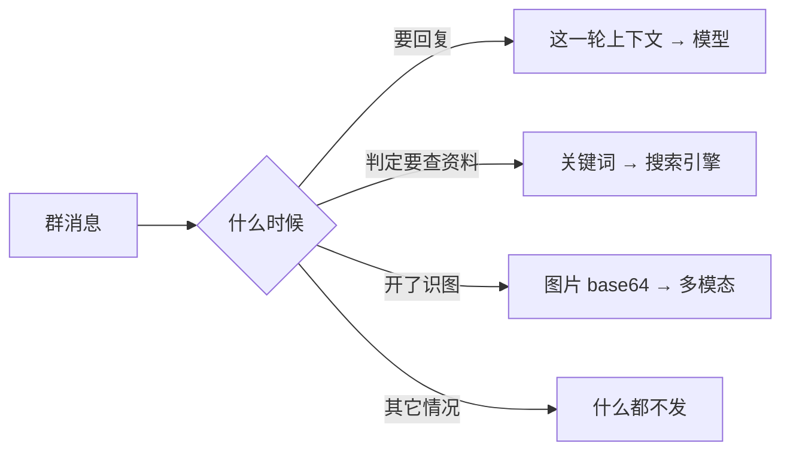

# 隐私与数据

**一句话：没有遥测、没有回传、没有账号系统；群聊数据只在本机，原文不落盘。**

## 数据怎么分类

| 数据 | 存哪 | 会不会离开这台机器 |
|---|---|---|
| 群消息原文 | **不落盘** | 只在**要回复时**，把这一轮必需的上下文拼进 prompt 送给模型 |
| 判定记录（关键词、统计、判决） | `app/dsh-data/data/observe.jsonl` | 不会 |
| 群档案 | `app/dsh-data/data/profiles/g-<群号>.json` | 不会 |
| 标注队列（≤40 字摘要） | `app/dsh-data/data/labels.jsonl` | 不会 |
| **API Key** | `app/dsh-data/config/secrets.json`（**gitignored**） | 只用于调用模型本体 |
| 语音 wav / 下载的图片 | `app/dsh-data/data/` | 图片会 base64 送多模态（**仅当开了识图**） |
| 运行日志 | `app/dsh-data/logs/bot.log` | 不会 |

## 会离开这台机器的三样东西

三样**都能分别关掉**：

| 外发 | 怎么关 |
|---|---|
| 送模型的上下文 | 没有开关（关了就不能回复）；但**本地判定会先拦掉大部分消息** |
| 搜索关键词 | 调整 → 搜索 → 通道设为不搜；或「额外功能」里关掉插件只用内置 |
| 图片送多模态 | 「额外功能 → 识图」关掉（**默认就是关的**） |

## 凭据

- 只存在 `app/dsh-data/config/secrets.json`，**在 .gitignore 里**
- 配置端读配置时**只回显掩码**（例如 `sk-1234****abcd`），**永远不会**把完整 key 发给浏览器
- 日志里也不会打印 key
- 打包分发版时有**双闸门自检**：白名单 + 内容扫描（`sk-[A-Za-z0-9]{16,}`），命中就拒绝出包

## 这个仓库里有什么 / 没有什么

**有**：程序源码、人设模板、提示词、测试与演示、Windows 托盘启动器源码与已编译 exe、作者的角色立绘。

**没有**：任何人的 API Key · 任何运行期数据 · 群消息或会话记录 · 表情包图库素材
（内置那套图库的授权是 personal，**不能随程序分发**；仓库里只有代码引用路径）。

## 分发时要注意

如果你要把「分发版」给朋友：

1. `node dist/build-package.mjs` 走的是**白名单打包**，不含运行期数据、不含图库素材、不含密钥
2. 打包后有**成品复查**，命中黑名单会报错
3. 提醒对方：**用自己的 key**（本项目 BYO key，不代付）

## 上线前请做这三件事

1. **征得群主与管理员同意** —— 群不是你一个人的
2. **让群里的人知道有个机器人在听** —— 别默认大家都知道
3. **先跑观察模式** —— 默认就是观察 80 条，这段时间它一个字都不发，正好用来看看它判得准不准

## 已知的隐私边界（诚实说明）

- 模型提供方（你选的 DeepSeek 或社区插件的免费池）**会看到送去的上下文**。免费池的模型卡里明确写过 prompt 可能被上游记录并用于改进服务 —— **别把敏感内容喂给免费通道**。
- 本地判定虽然不调模型，但**判定依据（关键词）会存到 observe.jsonl** 供学习用。想彻底不留，删掉那个文件即可，代价是自学习会重新开始。
- NapCat 是第三方程序，它自己的日志与行为不在本项目控制范围内。

## 数据清理

| 想清理 | 删掉 |
|---|---|
| 全部运行期数据 | `app/dsh-data/`（配置和密钥也在这里，注意先备份 `config/`） |
| 只是学习成果 | `app/dsh-data/data/` |
| 只清某个群 | `app/dsh-data/data/profiles/g-<群号>.json` + 从 observe.jsonl 里过滤掉该 `gid` |
| 语音/图片缓存 | `app/dsh-data/data/voice/` `app/dsh-data/data/brain/images/` |

- 语音转写（可选）：音频**只在你的机器上**处理（tools/stt-server.py 只监听 127.0.0.1，ffmpeg 本地转码）；
  只有你显式把 `runtime.stt.endpoint` 指到外部服务时音频才会外发；本程序默认不是那样。
